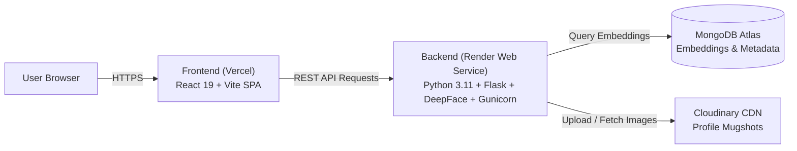

# FORENSIGHT Deployment Guide (Vercel + Render)

This guide walks you through deploying **FORENSIGHT** to production using **Render** for the Python Flask/DeepFace backend and **Vercel** for the Vite React frontend.

---

## Architecture Overview



---

## Prerequisites

1. **GitHub Account**: Push this repository to your GitHub profile.
2. **MongoDB Atlas Account**: A cloud MongoDB database cluster with a connection URI.
3. **Cloudinary Account**: Cloud name, API key, and API secret.
4. **Render Account**: [render.com](https://render.com) for backend hosting.
5. **Vercel Account**: [vercel.com](https://vercel.com) for frontend hosting.

---

## Step 1: Deploy Backend to Render

You can deploy the backend using either **Render Blueprints (Automated)** or **Manual Web Service**.

### Option A: Render Blueprint (Recommended - One Click)

1. Log into your [Render Dashboard](https://dashboard.render.com).
2. Click **New +** $\rightarrow$ **Blueprint**.
3. Connect your GitHub repository.
4. Render will detect `render.yaml` automatically.
5. In the configuration screen, provide the secret environment variables:
   - `MONGO_CONNECTION_STRING`: Your MongoDB Atlas URI.
   - `CLOUDINARY_CLOUD_NAME`: Your Cloudinary Cloud Name.
   - `CLOUDINARY_API_KEY`: Your Cloudinary API Key.
   - `CLOUDINARY_API_SECRET`: Your Cloudinary API Secret.
   - `ADMIN_SECRET_KEY`: A strong secret passcode for admin enrollment (e.g., `admin123`).
   - `ALLOWED_ORIGINS`: Comma-separated allowed frontend domains, e.g.:
     ```text
     https://*.vercel.app,http://localhost:5173
     ```
     *(You can add your specific production Vercel URL once generated).*
6. Click **Apply**. Render will build and deploy the backend.

---

### Option B: Manual Web Service Setup

If you prefer setting up the web service manually:

1. Click **New +** $\rightarrow$ **Web Service**.
2. Connect your GitHub repository.
3. Configure settings:
   - **Name**: `forensight-backend`
   - **Region**: Choose the closest region to you (e.g., Singapore, Frankfurt, Oregon).
   - **Branch**: `main`
   - **Root Directory**: `Backend`
   - **Runtime**: `Python 3` (or choose `Docker` to build from `Backend/Dockerfile`)
   - **Build Command**:
     ```bash
     python -m pip install --upgrade pip setuptools wheel && pip install -r requirements.txt
     ```
   - **Start Command**:
     ```bash
     gunicorn app:app -b 0.0.0.0:$PORT -w 1 --threads 4 --timeout 180
     ```
   - **Plan**: `Starter` (recommended for DeepFace/TensorFlow models; free tier works with 1 worker).
4. Under **Advanced** $\rightarrow$ **Health Check Path**: set `/api/health`.
5. Under **Environment Variables**, add:

| Key | Value / Description |
|---|---|
| `PYTHON_VERSION` | `3.11.9` |
| `FLASK_SECRET_KEY` | *(Click "Generate" or provide a random 32-char string)* |
| `ADMIN_SECRET_KEY` | Your admin authorization secret (e.g. `admin123`) |
| `MONGO_CONNECTION_STRING` | `mongodb+srv://...` |
| `CLOUDINARY_CLOUD_NAME` | `your_cloud_name` |
| `CLOUDINARY_API_KEY` | `your_api_key` |
| `CLOUDINARY_API_SECRET` | `your_api_secret` |
| `ALLOWED_ORIGINS` | `https://*.vercel.app,http://localhost:5173` |
| `MATCH_THRESHOLD` | `0.3` |
| `FACE_MODEL` | `Facenet512` |
| `FACE_DETECTOR` | `retinaface` |
| `EMBEDDING_TIMEOUT_SECONDS` | `180` |

6. Click **Create Web Service**.

---

### Verify Backend Deployment

Once Render finishes deploying, visit your service URL:
- `https://<your-render-subdomain>.onrender.com/api/health`

You should receive:
```json
{
  "service": "FORENSIGHT Face Recognition API",
  "status": "healthy",
  "timestamp": "2026-10-19T22:00:00.000000+00:00"
}
```

Copy your Render Backend URL (e.g., `https://forensight-backend.onrender.com`). You will need it for the frontend.

---

## Step 2: Deploy Frontend to Vercel

1. Log into your [Vercel Dashboard](https://vercel.com).
2. Click **Add New...** $\rightarrow$ **Project**.
3. Import your GitHub repository.
4. In the **Configure Project** screen:
   - **Framework Preset**: `Vite` (automatically detected).
   - **Root Directory**: Click **Edit** and select `Frontend`.
   - **Build Command**: `npm run build` (default).
   - **Output Directory**: `dist` (default).
5. Expand **Environment Variables**:
   - Add the variable:
     - **Name**: `VITE_API_BASE`
     - **Value**: `https://<your-render-subdomain>.onrender.com` *(no trailing slash)*
6. Click **Deploy**.

> [!NOTE]
> `Frontend/vercel.json` is already configured in the repository with rewrite rules to ensure client-side routing (`/results`, `/members`, `/upload`, `/login`) works on page refresh without 404 errors.

---

## Step 3: Configure CORS in Render

Now that Vercel has generated your production frontend URL (e.g., `https://forensight-sketch.vercel.app`):

1. Go back to your [Render Dashboard](https://dashboard.render.com).
2. Select your `forensight-backend` service.
3. Go to **Environment**.
4. Update `ALLOWED_ORIGINS` to include your exact domain:
   ```text
   https://forensight-sketch.vercel.app,https://*.vercel.app,http://localhost:5173
   ```
5. Click **Save Changes**. Render will automatically redeploy the service with the new CORS configuration.

---

## Step 4: Database Seeding (First-time setup)

To enroll the dataset of 52 criminal face profiles into your live MongoDB Atlas database and Cloudinary CDN:

Run the enrollment script from your local machine (with your Atlas connection string in `Backend/.env`):
```bash
cd Backend
python enroll_dataset.py
```
This uploads the dataset photos to Cloudinary and computes the 512-dimensional Facenet512 embeddings into MongoDB Atlas.

---

## Troubleshooting & FAQ

### 1. Vercel returns 404 on page refresh
- **Cause**: React Router uses client-side routing with `BrowserRouter`.
- **Solution**: Verify `Frontend/vercel.json` exists with the rewrite rule:
  ```json
  {
    "rewrites": [
      { "source": "/(.*)", "destination": "/index.html" }
    ]
  }
  ```

### 2. Render backend throws Worker Timeout (Error 502 / Worker killed)
- **Cause**: Computing DeepFace Facenet512 / RetinaFace embeddings on CPU takes 5–15 seconds, exceeding the default 30-second gunicorn timeout.
- **Solution**: Ensure your Gunicorn start command specifies `--timeout 180`:
  ```bash
  gunicorn app:app -b 0.0.0.0:$PORT -w 1 --threads 4 --timeout 180
  ```

### 3. Out of Memory (OOM / Exit code 137) on Render
- **Cause**: Running multiple worker processes (`-w 4`) duplicates TensorFlow model memory in separate processes.
- **Solution**: Use `-w 1 --threads 4`. This runs a single master worker with multithreading, keeping memory footprint under 400MB.

### 4. CORS Error: "No 'Access-Control-Allow-Origin' header is present"
- Verify that `ALLOWED_ORIGINS` in Render contains your frontend Vercel URL or `https://*.vercel.app`.
- If testing temporarily, you can set `ALLOWED_ORIGINS=*` on Render.
