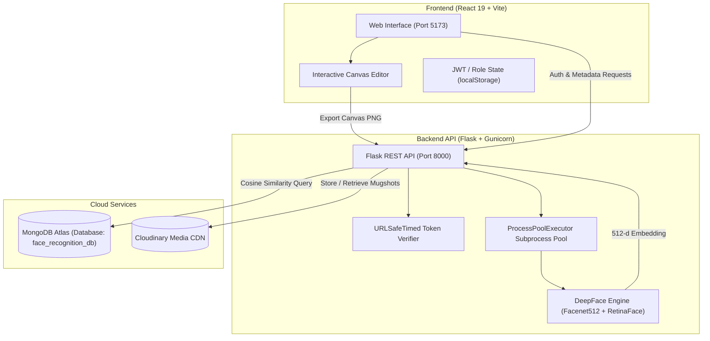

# FORENSIGHT — Criminal Face Generation and Recognition

> **AI-Powered Forensic Composite Construction & DeepFace Suspect Identification System**  
> *Developed as a 6th Semester Minor Project at Maulana Azad National Institute of Technology (MANIT), Bhopal.*

---

## 📌 Overview

Traditional criminal identification often relies heavily on manual forensic sketching, which is slow, subjective, and dependent on sketch artist availability. **FORENSIGHT** automates and modernizes this process through an end-to-end digital pipeline:

1. **Modular Composite Generation**: Witnesses or law enforcement officers interactively assemble a suspect's facial composite using modular facial components (hair, eyes, eyebrows, nose, lips, beard, moustache, ears).
2. **Feature Extraction via Deep Learning**: The constructed composite (or uploaded mugshot) is processed by a deep convolutional network (**DeepFace** with **Facenet512** and **RetinaFace**) to extract a normalized 512-dimensional facial embedding vector.
3. **High-Speed Database Matching**: The query vector is matched against pre-enrolled criminal records in **MongoDB Atlas** using **Cosine Similarity**, surfacing ranked suspect profiles in seconds.
4. **Cloud-Hosted Evidence**: Criminal mugshots and generated composites are stored securely using **Cloudinary CDN**.

---

## 🏗️ System Architecture



---

## ✨ Key Features

- **Interactive Composite Canvas**: Real-time canvas editor supporting element dragging, 8-handle resizing, layer ordering (Layer Up / Down), deletion, and keyboard shortcuts (`Arrow` keys for nudging, `Shift + Arrow` for layer shifting, `Delete` / `Backspace`).
- **Comprehensive Facial Asset Library**: Catalog of categorized PNG components: faces, eyes, eyebrows, noses, lips, hairstyles, beards, moustaches, and ears.
- **Deep Learning Recognition**: Powered by Google's `Facenet512` model with RetinaFace face detection and OpenCV fallback for robust feature representation.
- **Role-Based Access Control (RBAC)**: Secure access separation between `NORMAL` officers (search, match, browse) and `ADMIN` personnel (criminal enrollment, sensitive records management).
- **Automated Batch Dataset Enroller**: Includes `Backend/enroll_dataset.py` for automated extraction, Cloudinary CDN hosting, and MongoDB Atlas persistence of mugshot datasets.
- **Real-Time Member Search & Showcase**: Live member query engine with gender filtering and a randomized carousel of wanted suspects on the home page.

---

## 🛠️ Technology Stack

| Layer | Technologies |
| :--- | :--- |
| **Frontend** | React 19, Vite 8, React Router v7, Vanilla CSS Modules |
| **Backend** | Python 3.11+, Flask 3.0, Gunicorn, Werkzeug Security, itsdangerous |
| **Deep Learning** | DeepFace 0.0.99, TensorFlow 2.x, Facenet512, RetinaFace, OpenCV, NumPy |
| **Database** | MongoDB Atlas, PyMongo |
| **Cloud Storage** | Cloudinary API (Media CDN) |
| **Deployment** | Docker, Render (Backend API), Vercel (Frontend SPA) |

---

## 📁 Project Directory Structure

```text
ForenSight/project/
│
├── Backend/
│   ├── app.py                # Core Flask REST API & matching engine
│   ├── db_inspect.py         # MongoDB database inspection utility
│   ├── enroll_dataset.py     # Batch mugshot enrollment & embedding script
│   ├── requirements.txt      # Python dependencies (UTF-8)
│   ├── Dockerfile            # Container configuration for backend deployment
│   ├── Procfile              # Process manager descriptor (Gunicorn)
│   ├── runtime.txt           # Python runtime specification (python-3.11.9)
│   └── .env                  # Backend environment secrets (git-ignored)
│
├── Frontend/
│   ├── src/
│   │   ├── components/       # Header, Footer, CanvasArea, AssetPanel, LayersPanel, Toast
│   │   ├── hooks/            # useCanvas (canvas manipulation engine), useToast
│   │   ├── pages/            # Home, Editor, Results, Members, AdminUpload, Login, Signup
│   │   ├── utils/            # canvasUtils (CanvasElement classes, layer priorities, asset catalogue)
│   │   ├── App.jsx           # Application routes and navigation guards
│   │   ├── ProtectedRoute.jsx# Auth route guard
│   │   └── main.jsx          # React DOM entry point
│   ├── public/
│   │   └── assets/           # Facial components (eyes, nose, lips, hair, etc.) & branding
│   ├── package.json          # Node dependencies & scripts
│   ├── vite.config.js        # Vite bundler configuration
│   └── eslint.config.js      # ESLint static analysis configuration
│
├── faces/                    # Mugshots dataset (CFD-IM Indian Male, CFD-IF Indian Female)
├── .env.example              # Sample environment template
├── .gitignore                # Comprehensive git ignore rules
├── DEPLOY.md                 # Production deployment guide (Render + Vercel)
├── render.yaml               # Infrastructure-as-code for Render web service
└── README.md                 # Project documentation
```

---

## 🚀 Getting Started

### Prerequisites

- **Python 3.10+** (Python 3.11 recommended)
- **Node.js 18+** and **npm**
- **MongoDB Atlas** account (or local MongoDB instance)
- **Cloudinary** account (free tier works)

---

### 1. Environment Configuration

Copy `.env.example` to `Backend/.env`:

```bash
# In Backend/.env
FLASK_SECRET_KEY=your_strong_secret_key
MONGO_CONNECTION_STRING=mongodb+srv://<user>:<password>@cluster.mongodb.net/
CLOUDINARY_CLOUD_NAME=your_cloud_name
CLOUDINARY_API_KEY=your_api_key
CLOUDINARY_API_SECRET=your_api_secret
ADMIN_SECRET_KEY=your_admin_passcode

# Optional Model Settings
MATCH_THRESHOLD=0.3
FACE_MODEL=Facenet512
FACE_DETECTOR=retinaface
ALLOWED_ORIGINS=http://localhost:5173,http://127.0.0.1:5173
```

---

### 2. Backend Setup

```bash
cd Backend

# Create & activate a virtual environment
python -m venv .venv

# Windows PowerShell:
.\.venv\Scripts\Activate.ps1
# Linux / macOS:
source .venv/bin/activate

# Install dependencies
pip install -r requirements.txt

# Run the Flask server
python app.py
```
> The API server will be available at: `http://127.0.0.1:8000`

---

### 3. Frontend Setup

In a new terminal window:

```bash
cd Frontend

# Install Node modules
npm install

# Start Vite development server
npm run dev
```
> The web application will launch at: `http://localhost:5173`

---

### 4. (Optional) Batch Enrolling the Dataset

To automatically enroll sample mugshots from the `faces/` directory into Cloudinary and MongoDB:

```bash
python Backend/enroll_dataset.py
```

To verify database status and document counts at any time:

```bash
python Backend/db_inspect.py
```

---

## 🚀 Deployment (Vercel & Render)

FORENSIGHT is pre-configured for zero-friction cloud deployment:
- **Frontend**: Deployed to [Vercel](https://vercel.com) (Vite React SPA with client routing rewrites in `Frontend/vercel.json`).
- **Backend**: Deployed to [Render](https://render.com) using Blueprint `render.yaml` or `Backend/Dockerfile` (Python 3.11 + DeepFace + Gunicorn with dynamic `$PORT` and worker timeout guards).

👉 **For comprehensive, step-by-step instructions, see [DEPLOY.md](DEPLOY.md).**

---

## 📡 API Reference

| Endpoint | Method | Auth | Description |
| :--- | :--- | :--- | :--- |
| `/api/health` | `GET` | Public | Health status check for uptime monitors & Render |
| `/api/auth/signup` | `POST` | Public | Create a user (`NORMAL` or `ADMIN` with secret key) |
| `/api/auth/login` | `POST` | Public | Authenticate and obtain signed Bearer token |
| `/api/upload` | `POST` | Bearer Token | Upload query image/sketch, extract embedding, return ranked matches |
| `/api/enroll` | `POST` | Admin Bearer | Upload mugshot to Cloudinary and insert criminal record into DB |
| `/api/members` | `GET` | Bearer Token | Fuzzy name search for enrolled criminals with gender filter |
| `/api/latest-criminals` | `GET` | Public | Retrieve randomized suspect list for the homepage showcase |
| `/` | `GET` | Public | Root API service status and endpoint directory |

---

## 👨‍💻 Development Team

**Maulana Azad National Institute of Technology (MANIT), Bhopal**  
*Department of Computer Science & Engineering*

- **Anshul Rajpoot** (Scholar No. 2311401168)
- **Satyam Gupta** (Scholar No. 2311401167)
- **Ritesh Jat** (Scholar No. 2311401165)
- **Gajendra Verma** (Scholar No. 2311401211)

---

## 📄 License

This project was built for academic research and evaluation purposes. All sample face mugshots belong to the Chicago Face Database (CFD) research dataset.
